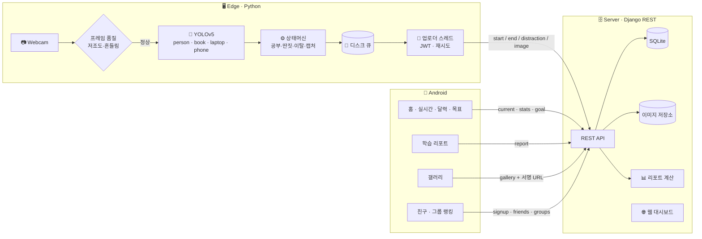
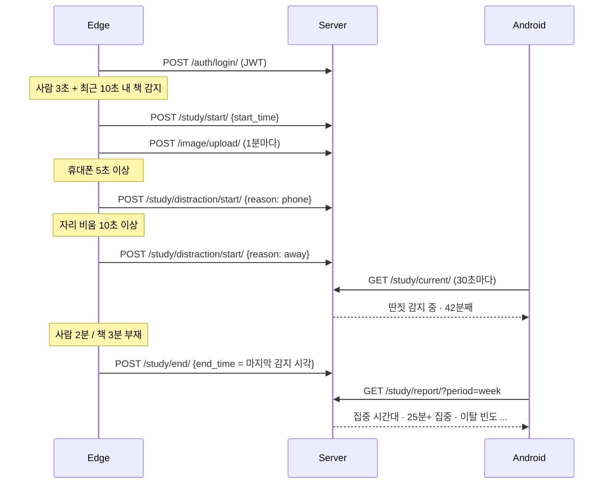
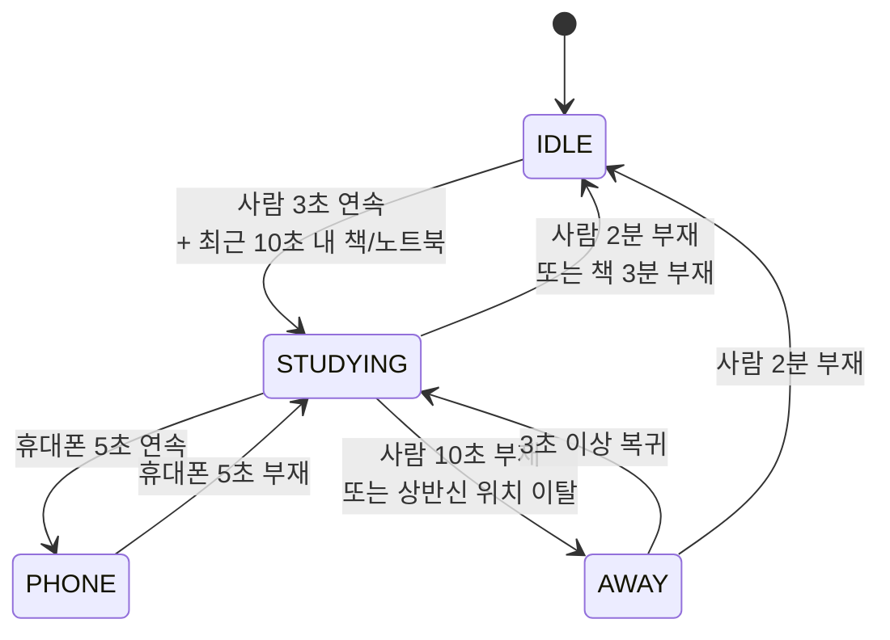
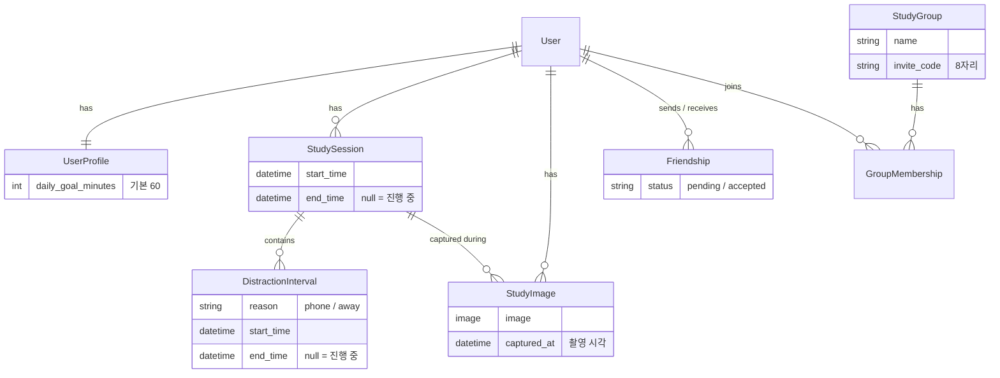

<div align="center">

# 📚 Study Lens

### 웹캠 기반 공부시간 자동 측정 & 학습 분석 서비스

**책을 펴고 앉으면 기록이 시작되고, 자리를 비우면 멈춥니다.**
휴대폰을 보거나 자리를 뜬 시간은 빼고 **순공부 시간**만 기록합니다.
집중이 잘 되는 시간대를 분석하고, 친구와 순위를 겨룰 수 있습니다.


-3DDC84?logo=android&logoColor=white)


[서비스 바로가기](https://doyoung.pythonanywhere.com/) · [무엇이 바뀌었나](#-v1--v2-무엇이-바뀌었나) · [기능](#-주요-기능) · [시작하기](#-시작하기) · [API](#-api-명세)

</div>

---

## 📖 목차

1. [v1 → v2 무엇이 바뀌었나](#-v1--v2-무엇이-바뀌었나)
2. [주요 기능](#-주요-기능)
3. [시스템 아키텍처](#️-시스템-아키텍처)
4. [감지 & 판정 로직](#-감지--판정-로직)
5. [학습 리포트](#-학습-리포트)
6. [화면 구성](#-화면-구성)
7. [프로젝트 구조](#-프로젝트-구조)
8. [시작하기](#-시작하기)
9. [API 명세](#-api-명세)
10. [데이터 모델](#️-데이터-모델)
11. [테스트](#-테스트)
12. [보안 & 개인정보](#-보안--개인정보)
13. [배포 (PythonAnywhere)](#️-배포-pythonanywhere)

---

## 🔄 v1 → v2 무엇이 바뀌었나

v1(기말 프로젝트 제출 버전)에서는 "사람 + 책 감지 → 공부 시간 기록 → 사진 갤러리"까지 구현했습니다.
v2에서는 **정확도, 학습 분석, 함께 공부하기, 안정성, 보안**을 크게 보강했습니다.

### 한눈에 보기

| 영역 | v1 | v2 |
| :--- | :--- | :--- |
| **공부 시간** | 세션이 짧아도 최소 3분으로 보정, 종료 유예 시간(3분)까지 포함 | 보정 없이 **실제 시간**만 기록. 종료 시각은 마지막으로 감지된 시각, 자정을 넘긴 세션은 날짜별로 나눔 |
| **순공부** | 앉아 있던 시간 전체를 공부로 집계 | 📱 **휴대폰 사용**과 🚶 **자리 이탈**을 빼고 **순공부 · 집중도(%)**를 계산 |
| **자리 이탈** | 없음 | 사람이 잠깐 안 보이거나 **상반신 위치가 크게 벗어나면** 이탈로 기록 |
| **학습 분석** | 일별 공부 시간 | ⏰ 집중 잘 되는 시간대, 🔥 25분 이상 연속 집중 구간, 이탈 빈도, 이전 기간 대비, 연속 공부 일수 |
| **목표** | 앱에 60분 고정 | 🎯 사용자별 **하루 목표** 설정, **목표 달성률 그래프** |
| **실시간** | 없음 | 🟢 "지금 공부 중 · 42분째" / "딴짓 감지 중" 표시 |
| **회원** | 관리자가 계정을 만들어 줘야 함 | 👤 앱·웹에서 **직접 가입** |
| **소셜** | 없음 | 🏆 **친구 랭킹**, 👥 **스터디 그룹** (초대 코드, 그룹 랭킹) |
| **갤러리** | 날짜별 조회 API가 없어 앱 갤러리가 동작하지 않음 | 날짜별 갤러리 API 추가, 업로드가 늦어도 **촬영 시각** 기준으로 표시 |
| **Edge 안정성** | 네트워크가 끊기면 프로그램이 종료되고 토큰이 만료되면 전송 실패 | 💾 **디스크 큐** + 백그라운드 전송 + 재시도, **토큰 자동 갱신** |
| **보안** | 비밀키·디버그 설정·테스트 계정이 코드에 있음, 사진이 `/media/`로 공개 | 🔐 비밀값은 **환경변수**로, 사진은 **서명된 URL**로만 제공, 업로드 검증과 EXIF 제거 |
| **Android** | 2025년 12월 고정 달력, 통계 필드 이름 불일치로 공부 시간이 0으로 표시 | 동적 달력(월 이동), 필드 수정, 리포트·친구·그룹 화면 추가 |
| **테스트** | 없음 | 서버 55개 + Edge 24개 = **79개** |

<details>
<summary><b>📋 세부 변경 목록 펼치기</b></summary>

#### 🧠 Edge (감지)
- 코드를 `detector.py`(추론), `study_state.py`(판정 상태머신), `api_client.py`(통신)로 분리했습니다. 판정 로직은 카메라 없이 단위 테스트할 수 있습니다.
- **시작 조건:** 사람이 3초 이상 계속 보이고, 책이나 노트북이 **최근 10초 안에 한 번이라도** 감지되면 시작합니다. 책 인식이 불안정한 점을 보완한 것입니다.
- **종료 조건:** 사람이 2분, 또는 책·노트북이 3분 이상 안 보이면 종료합니다.
- **딴짓:** 휴대폰(COCO 67)이 5초 이상 계속 보이면 딴짓으로 기록합니다.
- **자리 이탈:**
  - 사람이 10초 이상 안 보이면 이탈입니다.
  - 상반신(사람 박스) 중심이 앉은 자세 기준점에서 25% 넘게 벗어나면 이탈입니다.
  - 자리를 옮겨 앉아 계속 공부하면 1분 뒤 새 위치를 기준점으로 잡고, 그 이탈 구간은 취소합니다.
- **안정성:**
  - 최근 1.5초 동안의 프레임 다수결로 판정해 한두 프레임이 튀는 것을 무시합니다.
  - 추론은 초당 4회로 제한합니다.
  - 같은 경고 로그는 30초에 한 번만 남기고, 로그 파일은 2MB마다 새로 만듭니다.
  - 자리 이탈 중에는 캡처하지 않습니다.
- **통신:**
  - 이벤트를 디스크 큐에 먼저 저장하고 백그라운드로 순서대로 전송합니다. 프로그램을 다시 켜도 이벤트가 사라지지 않습니다.
  - 전송에 실패하면 간격을 늘려가며 재시도하고, 토큰이 만료되면 자동으로 다시 발급받습니다.

#### 🗄️ Server
- **시간 계산:** 최소 3분 보정을 없앴습니다. Edge가 보낸 실제 시작·종료 시각을 검증해서 쓰고, 자정을 넘긴 세션은 날짜별로 나눕니다.
- **딴짓·자리 이탈 기록:** 구간 단위로 저장합니다. 휴대폰과 자리 이탈이 겹치면 합쳐서 한 번만 뺍니다.
- **새 API:** 실시간 상태(`/study/current/`), 날짜별 갤러리, 하루 목표, 요약·리포트(`/study/summary/`, `/study/report/`)를 추가했습니다.
- **소셜:** 회원가입, 친구(요청·수락·랭킹), 스터디 그룹(초대 코드·방장·그룹 랭킹)을 추가했습니다.
- **보안:** 설정을 환경변수로 옮겼고, 사진은 서명된 URL로만 제공합니다. 업로드 이미지를 검증하고 줄인 뒤 EXIF를 지우며, 가입·요청에 횟수 제한을 걸었습니다.
- **정리:** URL을 `/api/`와 웹으로 나누고, 쓰지 않는 `accounts` 앱을 지웠습니다. `requirements.txt`와 `.env.example`을 추가했습니다.

#### 🌐 Web 대시보드
- 실시간 상태, 오늘 순공부와 목표 진행률을 보여줍니다.
- 최근 7일 차트에 목표선과 달성 여부 색상을 표시합니다.
- **이번 주 리포트**(집중 시간대, 25분+ 집중, 이탈·휴대폰 횟수, 인사이트), 친구 랭킹 Top 5, 회원가입 페이지를 추가했습니다.

#### 📱 Android
- 날짜를 `yyyy-MM-dd` 형식으로 주고받습니다.
- 현재 달 기준의 동적 달력을 만들고, 이전/다음 달로 이동할 수 있습니다.
- 홈 화면에 다음을 추가했습니다.
  - 실시간 상태 (30초마다 갱신)
  - 순공부와 집중도
  - **하루 목표 설정**과 **최근 7일 목표 달성 그래프**
- **학습 리포트**, **회원가입**, **친구 랭킹**, **스터디 그룹** 화면을 추가했습니다.
- 토큰이 만료되면 자동으로 갱신합니다.

</details>

---

## ✨ 주요 기능

| | 기능 | 설명 |
| :---: | :--- | :--- |
| 🤖 | **자동 기록** | 사람이 앉아 있고 책·노트북이 보이면 자동으로 시작하고, 자리를 떠나거나 책을 치우면 자동으로 종료합니다. |
| 📱 | **딴짓 감지** | 공부 중에 휴대폰이 5초 이상 보이면 딴짓 구간으로 기록합니다. |
| 🚶 | **자리 이탈 감지** | 잠깐 자리를 비우거나 상반신이 크게 움직이면(일어남 등) 이탈 구간으로 기록합니다. |
| ⏱️ | **순공부 · 집중도** | 순공부는 전체 공부 시간에서 딴짓·이탈 시간을 뺀 시간이고, 집중도는 순공부 ÷ 전체입니다. |
| 🎯 | **하루 목표** | 목표 순공부 시간을 직접 정하고, 날짜별 달성 여부를 그래프로 확인합니다. |
| 📊 | **학습 리포트** | 집중 잘 되는 시간대, 25분 이상 연속 집중 구간, 이탈 빈도, 이전 기간 대비 증감, 연속 공부 일수를 보여줍니다. |
| 🟢 | **실시간 상태** | "지금 공부 중 · 42분째"를 앱과 웹에 표시합니다. |
| 📸 | **공부 사진** | 공부 중 1분마다 캡처해서 날짜별 갤러리로 보여줍니다. |
| 👤 | **회원가입** | 앱이나 웹에서 바로 가입합니다. |
| 🏆 | **친구 랭킹** | 아이디로 친구를 추가하고 오늘 / 최근 7일 / 이번 달 순공부 순위를 비교합니다. |
| 👥 | **스터디 그룹** | 8자리 초대 코드로 모여서(최대 30명) 그룹 랭킹을 겨룹니다. |
| 🌙 | **노이즈 필터** | 너무 어둡거나 카메라가 흔들린 프레임은 판정에서 뺍니다. |
| 📡 | **오프라인 대응** | 네트워크가 끊겨도 이벤트를 저장해 두었다가 연결되면 자동으로 전송합니다. |

---

## 🏗️ 시스템 아키텍처



### 이벤트 흐름



---

## 🧠 감지 & 판정 로직

판정 로직은 카메라·모델과 분리된 **순수 상태머신**(`edge/study_state.py`)이라 단위 테스트로 검증합니다.

### 감지 대상 (COCO Pretrained YOLOv5s)

| 클래스 | COCO ID | 신뢰도 | 역할 |
| :--- | :---: | :---: | :--- |
| 🧑 person | 0 | 0.45 | 필수 조건 + **상반신 위치**(자리 이탈 판정) |
| 📖 book | 73 | 0.25 | 공부 물체 |
| 💻 laptop | 63 | 0.25 | 공부 물체 |
| 📱 cell phone | 67 | 0.35 | 딴짓 판정 |

> book·laptop은 COCO 학습 데이터가 적어서 인식이 불안정합니다. 그래서 신뢰도 기준을 낮추고, **"최근 10초 안에 한 번이라도"** 보였으면 인정합니다.

### 상태 전이



### 판정 규칙

| 규칙 | 내용 | 설정 (`edge/config.py`) |
| :--- | :--- | :--- |
| **다수결 평활화** | 최근 1.5초 동안의 프레임 중 50% 이상에서 감지돼야 '있음'으로 봅니다. | `VOTE_WINDOW_SEC`, `VOTE_RATIO` |
| **공부 시작** | 사람이 3초 이상 계속 보이고, 책·노트북이 최근 10초 안에 보였으면 시작합니다. | `MIN_STUDY_DETECTION_SEC`, `OBJECT_START_MEMORY_SEC` |
| **공부 종료** | 사람이 2분, 또는 책이 3분 이상 안 보이면 종료합니다. 종료 시각은 **마지막으로 감지된 시각**입니다. | `PERSON_ABSENT_SEC`, `STUDY_OBJECT_MEMORY_SEC` |
| **딴짓 (휴대폰)** | 휴대폰이 5초 이상 계속 보이면 시작하고, 5초 이상 안 보이면 끝납니다. | `PHONE_MIN_SEC`, `PHONE_CLEAR_SEC` |
| **자리 이탈** | 사람이 10초 이상 안 보이거나, 상반신 중심이 기준점에서 화면 대비 25% 이상 벗어나면 시작합니다. 3초 이상 돌아와 있으면 끝납니다. | `AWAY_MIN_SEC`, `AWAY_MOVE_RATIO`, `AWAY_CLEAR_SEC` |
| **기준점 재설정** | 위치만 다르고 사람·책은 계속 보이면(자리를 옮겨 앉음) 1분 뒤 새 위치를 기준점으로 잡고, 그 이탈 구간은 취소합니다. | `AWAY_REBASE_SEC`, `BASELINE_ALPHA` |
| **캡처** | 공부를 시작할 때 1장, 그 뒤 60초마다 1장 찍습니다(긴 변 960px). 자리 이탈 중에는 찍지 않습니다. | `CAPTURE_INTERVAL_SEC`, `UPLOAD_MAX_SIDE` |
| **노이즈 필터** | 평균 밝기가 40 미만이거나 연속 프레임 차이가 25를 넘으면 그 프레임을 무시합니다. | `LOW_BRIGHTNESS_THRESHOLD`, `MOTION_THRESHOLD` |
| **추론 주기** | 초당 4회만 추론합니다. | `INFERENCE_FPS` |

> 💡 **순공부 = 세션 시간 − (휴대폰 ∪ 자리 이탈)**: 두 구간이 겹치면 한 번만 뺍니다.
> 💡 **집중도 = 순공부 ÷ 세션 시간 × 100**

---

## 📊 학습 리포트

`GET /api/study/report/?period=today|week|month`로 받는 분석 항목입니다. 앱의 리포트 화면과 웹 대시보드에서 보여줍니다.

| 항목 | 계산 방법 |
| :--- | :--- |
| ⏰ **집중 잘 되는 시간대** | 순공부 구간을 1시간 단위로 나눠 **24칸 분포**를 만들고, 상위 3개 시간과 가장 많이 공부한 시간대(새벽·오전·오후·저녁)를 뽑습니다. |
| 🔥 **25분 이상 연속 집중** | 딴짓·자리 이탈 없이 **25분 이상 이어진 순공부 구간**의 횟수, 합계, 최장 시간과 목록입니다. |
| 🚶 **자리 이탈 빈도** | 이탈 횟수, 총 시간, **공부 1시간당 이탈 횟수**, 일별 횟수입니다. |
| 📱 **휴대폰 사용 빈도** | 사용 횟수, 총 시간, 공부 1시간당 횟수입니다. |
| 🎯 **목표 달성** | 하루 목표를 달성한 일수와 달성률, 연속 달성 일수입니다. |
| 📈 **이전 기간 대비** | 같은 길이의 직전 기간과 비교한 순공부 증감률(%)입니다. |
| 🔥 **연속 공부** | 오늘까지 하루도 빠지지 않고 공부한 일수입니다. 오늘 아직 기록이 없으면 어제까지 셉니다. |
| 💡 **인사이트** | "가장 집중이 잘 되는 시간은 21시~22시예요" 같은 한 줄 요약입니다. |

---

## 📱 화면 구성

| 화면 | 내용 |
| :--- | :--- |
| **로그인 / 회원가입** | JWT로 로그인합니다. 가입하면 바로 로그인되고, 다음 실행부터는 자동으로 로그인됩니다. |
| **홈** | 🟢 실시간 상태 · 🎯 오늘 순공부/목표(눌러서 목표 변경) · 📅 월별 달력 · 📊 최근 7일 목표 달성 그래프 · 각 화면 이동 버튼 |
| **학습 리포트** | 기간 탭 · 요약 카드 4개 · 한 줄 요약 · 목표 달성 그래프 · 시간대별 집중 그래프 · 25분+ 집중 목록 · 이탈/휴대폰 빈도 |
| **갤러리** | 선택한 날짜의 공부 사진을 2열 그리드로 보여줍니다. |
| **친구 랭킹** | 친구 요청 보내기, 받은 요청 수락·거절, 기간별 순공부 랭킹("공부 중" 표시). 친구를 길게 누르면 삭제할 수 있습니다. |
| **스터디 그룹** | 그룹 목록, 만들기, 초대 코드로 참여. 상세 화면에서는 초대 코드 복사·재발급, 그룹 랭킹, 나가기를 할 수 있습니다. |
| **웹 대시보드** | 실시간 상태, 오늘 순공부·목표, 7일 차트(목표선), **이번 주 리포트**, 친구 랭킹 Top 5, 오늘의 사진 |

---

## 📂 프로젝트 구조

```
studylens/
├── edge/                         # 🖥️ 웹캠 감지 장치
│   ├── edge.py                   #   메인 루프 (카메라 → 감지 → 이벤트)
│   ├── detector.py               #   YOLOv5 추론, 사람 박스 위치, 프레임 품질, 업로드 인코딩
│   ├── study_state.py            #   공부·딴짓·자리 이탈·캡처 판정 상태머신 (순수 로직)
│   ├── api_client.py             #   JWT 인증·갱신, 디스크 큐, 백그라운드 전송
│   ├── config.py                 #   모든 설정값 (계정은 환경변수)
│   └── tests/                    #   상태머신·API 클라이언트 테스트
│
├── server/                       # 🗄️ Django 서버
│   ├── studylens/                #   settings.py (환경변수), urls.py
│   ├── study/
│   │   ├── models.py             #   세션 · 딴짓/이탈 구간 · 이미지 · 친구 · 그룹 · 사용자 설정
│   │   ├── services.py           #   일별 집계, 구간 합치기, 랭킹, 이미지 처리, 서명 URL
│   │   ├── reports.py            #   요약·리포트 (시간대 분석, 25분+ 집중, 이탈 빈도 ...)
│   │   ├── views.py              #   공부 기록·리포트 API + 웹 대시보드·가입
│   │   ├── social_views.py       #   회원가입 · 목표 · 친구 · 스터디 그룹 API
│   │   ├── api_urls.py           #   /api/...
│   │   ├── web_urls.py           #   /, /signup/, /dashboard/, /logout/
│   │   └── tests.py · test_social.py · test_reports.py
│   └── templates/                #   로그인 · 회원가입 · 대시보드
│
└── client/                       # 📱 Android 앱
    └── app/src/main/java/com/studylens/client/
        ├── api/                  #   Retrofit 서비스, 토큰 자동 갱신, 에러 메시지
        ├── model/                #   DailyStat · CurrentStatus · ReportResponse · RankingResponse ...
        ├── ui/                   #   Login · Signup · Home · Report · StudyGallery · Friends · Groups ...
        │                         #   BarChartView (차트), PeriodTabs, RankingRenderer
        ├── adapter/              #   갤러리 어댑터
        └── util/                 #   Prefs(토큰) · TimeFormat
```

---

## 🚀 시작하기

### 1️⃣ Server

```bash
cd server
python -m venv venv && source venv/bin/activate   # Windows: venv\Scripts\activate
pip install -r requirements.txt

cp .env.example .env          # 로컬 개발이면 DJANGO_DEBUG=1 로 변경
python manage.py migrate
python manage.py runserver
```

- 웹 주소는 http://127.0.0.1:8000/ 입니다. 일반 사용자는 웹 `/signup/`이나 앱에서 가입합니다.
- 관리자 페이지(`/admin/`)용 계정은 `python manage.py createsuperuser`로 만듭니다.

<details>
<summary><b>서버 환경변수 목록</b></summary>

| 변수 | 기본값 | 설명 |
| :--- | :--- | :--- |
| `DJANGO_SECRET_KEY` | (필수) | 운영 환경의 비밀키입니다. `DJANGO_DEBUG=1`이면 개발용 키를 자동으로 씁니다. |
| `DJANGO_DEBUG` | `0` | 디버그 모드 |
| `DJANGO_ALLOWED_HOSTS` | `localhost,127.0.0.1` | 쉼표로 구분 |
| `DJANGO_CSRF_TRUSTED_ORIGINS` | – | 예: `https://doyoung.pythonanywhere.com` |
| `DJANGO_DB_PATH` / `DJANGO_MEDIA_ROOT` | `server/db.sqlite3` / `server/media` | 저장 경로 |
| `STUDYLENS_MAX_IMAGE_BYTES` | `5242880` | 업로드 이미지 최대 크기 (5MB) |
| `STUDYLENS_MAX_IMAGE_SIDE` | `1280` | 서버에 저장할 때 긴 변의 최대 픽셀 |
| `STUDYLENS_IMAGE_URL_MAX_AGE` | `3600` | 서명된 이미지 URL 유효 시간(초) |
| `STUDYLENS_MAX_BACKDATE_SEC` | `86400` | Edge가 보내는 과거 시각을 얼마나 이전까지 허용할지(초) |
| `STUDYLENS_SIGNUP_RATE` | `10/hour` | 같은 IP에서 허용하는 가입 횟수 |

</details>

### 2️⃣ Edge

```bash
cd edge
python -m venv venv && source venv/bin/activate
pip install -r requirements.txt

cp .env.example .env          # STUDYLENS_USERNAME / STUDYLENS_PASSWORD 입력
python edge.py                # 미리보기 창에서 q 또는 Ctrl+C 로 종료
```

- 처음 실행할 때 YOLOv5 모델을 `torch.hub`로 자동 다운로드합니다. 인터넷 연결이 필요합니다.
- 화면이 없는 환경에서는 `STUDYLENS_SHOW_PREVIEW=0`으로 실행합니다.
- 미리보기 창에 `STUDYING` / `DISTRACTED (phone)` / `AWAY` / `IDLE` 상태가 표시됩니다.
- 로그는 `edge/edge.log`에 남습니다. 보내지 못한 이벤트는 `edge/edge_queue/`에 저장했다가 다음 실행 때 보냅니다.

### 3️⃣ Android

1. Android Studio에서 `client/`를 엽니다.
2. 서버 주소는 `ApiClient.BASE_URL`에 있습니다. 로컬 서버로 테스트하려면 에뮬레이터에서 `http://10.0.2.2:8000/`을 씁니다.
3. 실행한 뒤 회원가입하거나 로그인합니다.

---

## 📡 API 명세

- 기본 경로는 `/api/`입니다.
- 인증은 `Authorization: Bearer <access>` 헤더로 합니다. 🔓 표시가 있는 엔드포인트는 인증이 필요 없습니다.
- 시각은 ISO-8601, 날짜는 `YYYY-MM-DD` 형식이며 Asia/Seoul 기준입니다.
- 기간 파라미터 `period`는 `today`(오늘), `week`(오늘 포함 최근 7일), `month`(이번 달 1일~오늘) 중 하나입니다.

### 인증 · 내 정보
| Method | Endpoint | 설명 |
| :---: | :--- | :--- |
| `POST` | `/auth/signup/` 🔓 | `{username, password, password2}` → `{user, access, refresh}` |
| `POST` | `/auth/login/` 🔓 | `{username, password}` → `{access, refresh}` |
| `POST` | `/auth/refresh/` 🔓 | `{refresh}` → `{access}` |
| `GET` | `/me/` | 내 정보, 하루 목표, 친구 수, 받은 요청 수, 그룹 수 |
| `GET` · `PATCH` | `/me/goal/` | 하루 목표 순공부 시간 `{daily_goal_minutes}` (10분 ~ 16시간) |

### 공부 세션 · 딴짓
| Method | Endpoint | Body (선택) | 설명 |
| :---: | :--- | :--- | :--- |
| `POST` | `/study/start/` | `start_time` | 세션을 시작합니다. 닫히지 않은 이전 세션은 마지막 활동 시각으로 닫습니다. |
| `POST` | `/study/end/` | `end_time` | 세션을 종료하고, 열려 있는 딴짓·이탈 구간도 닫습니다. |
| `GET` | `/study/current/` | – | 실시간 상태: 공부 중 여부, 경과 시간, `is_on_phone`, `is_away`, 오늘 통계 |
| `POST` | `/study/distraction/start/` | `start_time`, `reason` | `reason`은 `phone`(기본) 또는 `away`입니다. |
| `POST` | `/study/distraction/end/` | `end_time`, `reason` | 해당 사유의 구간을 닫습니다. `reason`을 생략하면 가장 최근 구간을 닫습니다. |

### 통계 · 리포트
| Method | Endpoint | 설명 |
| :---: | :--- | :--- |
| `GET` | `/stats/daily/?days=7` 또는 `?start=&end=` | 일별 전체·딴짓·순공부 시간, 집중도, **목표 달성률** |
| `GET` | `/study/summary/?period=` 또는 `?start=&end=` | 기간 합계, 목표 달성 일수, 일별 통계 |
| `GET` | `/study/report/?period=` 또는 `?start=&end=` | 위 요약에 더해 시간대 분석, 25분+ 집중, 이탈·휴대폰 빈도, 이전 기간 대비, 연속 일수, 인사이트 (최대 92일) |

<details>
<summary><b>GET /study/report/?period=week 응답 예시 (일부)</b></summary>

```json
{
  "period": "week", "start": "2026-11-18", "end": "2026-11-24",
  "totals": { "total_seconds": 23760, "focus_seconds": 22320, "focus_rate": 93.9, "study_days": 5 },
  "goal": { "daily_goal_minutes": 60, "achieved_days": 4, "days": 7, "achievement_rate": 57.1 },
  "best_hours": [{ "hour": 21, "label": "21시~22시", "focus_seconds": 14400 }],
  "best_time_band": { "name": "evening", "label": "저녁 (18~24시)", "focus_seconds": 19800 },
  "deep_focus": { "threshold_minutes": 25, "count": 9, "longest_seconds": 4020, "blocks": [ ... ] },
  "away": { "count": 2, "total_seconds": 300, "per_hour": 0.3 },
  "phone": { "count": 3, "total_seconds": 1080, "per_hour": 0.45 },
  "comparison": { "previous_focus_seconds": 15000, "change_rate": 48.8 },
  "streak": { "current_days": 3, "goal_current_days": 2 },
  "insights": ["가장 집중이 잘 되는 시간은 21시~22시예요.", "25분 이상 연속 집중을 9번 했어요. (최장 1시간 7분)"]
}
```
</details>

### 이미지 · 갤러리
| Method | Endpoint | 설명 |
| :---: | :--- | :--- |
| `POST` | `/image/upload/` | multipart 형식입니다. `image`(JPEG/PNG/WEBP, 최대 5MB), `session_id`, `captured_at` |
| `GET` | `/images/<id>/file/?token=` 🔓 | 서명된 URL로 이미지를 내려줍니다. 1시간 동안 유효합니다. |
| `GET` | `/gallery/?date=YYYY-MM-DD` | 해당 날짜의 이미지 목록. 날짜를 생략하면 오늘입니다. |

### 친구
| Method | Endpoint | 설명 |
| :---: | :--- | :--- |
| `GET` | `/friends/` | 친구 목록 |
| `DELETE` | `/friends/<user_id>/` | 친구 삭제 |
| `GET` · `POST` | `/friends/requests/` | 대기 중인 요청 목록 조회 / `{username}`으로 요청 보내기. 서로 요청하면 바로 친구가 됩니다. |
| `POST` | `/friends/requests/<id>/accept/` · `reject/` · `cancel/` | 요청 수락·거절·취소 |
| `GET` | `/friends/ranking/?period=` | 나와 친구들의 순공부 랭킹 (동점은 같은 순위) |

### 스터디 그룹
| Method | Endpoint | 설명 |
| :---: | :--- | :--- |
| `GET` · `POST` | `/groups/` | 내 그룹 목록 / `{name, description?}`으로 만들기 |
| `POST` | `/groups/join/` | `{invite_code}`로 참여합니다 (최대 30명). |
| `GET` · `DELETE` | `/groups/<id>/` | 상세 정보와 멤버 목록(멤버만) / 삭제(방장만) |
| `POST` | `/groups/<id>/leave/` | 나가기. 방장이 나가면 가장 먼저 가입한 멤버가 방장이 되고, 마지막 멤버가 나가면 그룹이 삭제됩니다. |
| `POST` | `/groups/<id>/invite-code/` | 초대 코드 재발급 (방장만) |
| `GET` | `/groups/<id>/ranking/?period=` | 그룹 순공부 랭킹 |

### 웹
| 경로 | 설명 |
| :--- | :--- |
| `/` · `/signup/` · `/logout/` | 로그인 · 회원가입 · 로그아웃 |
| `/dashboard/` | 실시간 상태, 오늘 순공부·목표, 7일 목표 차트, **이번 주 리포트**, 친구 랭킹, 오늘의 사진 |

---

## 🗃️ 데이터 모델



---

## 🧪 테스트

```bash
# 서버 (55개)
cd server && DJANGO_SECRET_KEY=local-test-secret-key-0123456789-abcdef python manage.py test study

# Edge (24개): torch·카메라 없이 실행됩니다
cd edge && python -m unittest discover -s tests
```

| 영역 | 주요 검증 항목 |
| :--- | :--- |
| 집계 | 자정 분할, 진행 중 세션 포함, 딴짓 차감, **휴대폰·이탈 겹침을 한 번만 차감**, 목표 달성 |
| 리포트 | 25분+ 연속 집중 구간, 시간대 분포·Top 3, 이탈·휴대폰 빈도, 이전 기간 대비, 연속 일수, 빈 기간 |
| 세션·이미지 | 시각 검증·보정, 닫히지 않은 세션 정리, 업로드 검증·리사이즈, 서명 URL 위조 차단, `/media/` 비공개 |
| 소셜 | 가입 검증·횟수 제한, 친구 요청·수락·삭제, 그룹 권한·방장 위임, 랭킹 동점 처리 |
| Edge 판정 | 책 간헐 감지 시작, 한 프레임 튐 무시, 유예 시간 제외, 딴짓, **자리 이탈·상반신 이동·기준점 재설정**, 이탈 중 캡처 생략 |
| Edge 통신 | 전송 순서, 재시작 후에도 큐 유지, 401 시 토큰 갱신, 4xx는 버리고 5xx는 재시도, 사유(reason) 전송 |

---

## 🔐 보안 & 개인정보

공부 사진은 사용자 얼굴이 찍힌 **개인정보**라서 아래처럼 처리합니다.

| 항목 | 처리 |
| :--- | :--- |
| 비밀값 | `SECRET_KEY`, `DEBUG`, 허용 호스트, Edge 계정을 모두 환경변수나 `.env`(git 제외)에서 읽습니다. 운영 기본값은 `DEBUG=False`입니다. |
| 사진 | `/media/`로는 공개하지 않고, **1시간 동안만 유효한 서명된 URL**로만 제공합니다. |
| 업로드 | 크기·포맷을 검사하고 실제 이미지인지 확인합니다. 다시 인코딩하면서 **EXIF(위치 정보 등)를 지웁니다**. |
| 소셜 공개 범위 | 친구·그룹 멤버에게는 **시간 합계와 "공부 중" 여부만** 보입니다. 사진과 세부 기록은 본인만 볼 수 있습니다. |
| 남용 방지 | 가입(IP당 시간당 10회), 친구 요청(시간당 60회), 그룹 참여(시간당 30회)에 횟수 제한이 있습니다. |
| 입력 검증 | 미래 시각은 현재 시각으로 바꾸고, 24시간보다 오래된 시각은 거부합니다. 날짜·기간 파라미터도 검증합니다. |

> ⚠️ v1 시절 커밋 이력과 발표 자료(pptx)에 테스트 계정 비밀번호가 남아 있습니다. **운영 계정의 비밀번호는 반드시 바꿔 주세요.**

---

## ☁️ 배포 (PythonAnywhere)

1. 코드를 업데이트한 뒤 패키지를 설치합니다.
   ```bash
   cd ~/studylens/server && pip install -r requirements.txt
   ```
2. `server/.env`를 만들고 `DJANGO_SECRET_KEY`, `DJANGO_DEBUG=0`, `DJANGO_ALLOWED_HOSTS`, `DJANGO_CSRF_TRUSTED_ORIGINS`를 설정합니다.
3. 마이그레이션을 실행합니다. 딴짓·이탈, 친구·그룹, 사용자 설정 테이블이 생기고, 기존 이미지의 촬영 시각이 채워집니다.
   ```bash
   python manage.py migrate
   ```
4. **Web 탭 → Static files**에 `/media/` 매핑이 있다면 **삭제**합니다. 이미지는 서명된 URL로만 제공됩니다.
5. 정적 파일을 모으고, `/static/` 매핑을 `server/staticfiles`로 설정합니다.
   ```bash
   python manage.py collectstatic
   ```
6. **Reload** 버튼을 눌러 반영합니다.

---

<div align="center">

Made with ☕ & 📚 by **doyoung0013**

</div>
